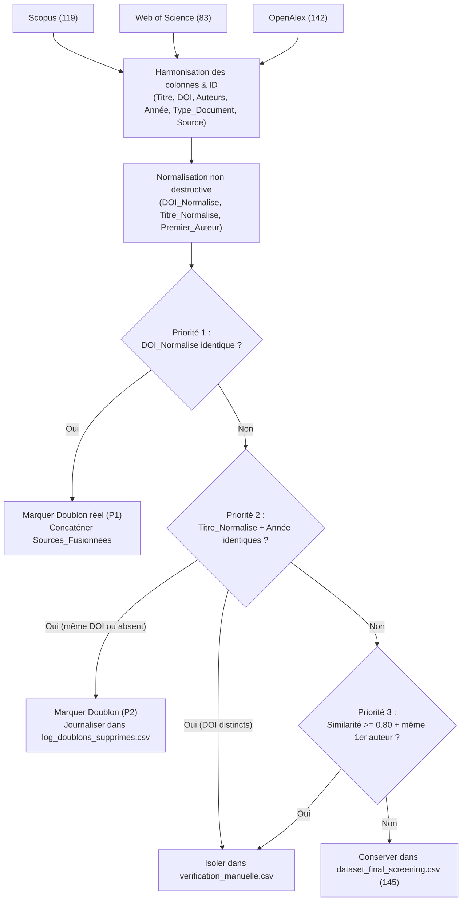

# Lab 5 — Fusion des résultats et suppression des doublons (PRISMA 2020)

**Revue systématique :** *Machine learning and remote sensing for disease and stress detection in olive* (PRISMA 2020 / PRISMA-S)  
**Sources fusionnées :** Scopus, Web of Science Core Collection, OpenAlex  
**Date d'exécution :** 24 novembre 2026  
**Résultat :** 344 enregistrements bruts → 199 doublons retirés → **145 références uniques** prêtes pour le screening (+ 8 paires ambiguës isolées pour vérification manuelle)

Ce dépôt implémente et documente les **14 étapes du Lab 5** : importation multi-bases, harmonisation des schémas, normalisation des titres et DOI, déduplication hiérarchique par priorité, distinction entre doublons réels et publications distinctes, traçabilité PRISMA et préparation du fichier final de screening.


---

## En bref

**Technologies.** **Python 3** (bibliothèque standard uniquement : `csv`, `re`, `unicodedata`, `difflib`, `unittest`) garantit une exécution sans dépendance externe et 100 % reproductible.

**Synthèse des comptages PRISMA** (`results/rapport_prisma_dedup.csv`) :

| Source | Enregistrements importés | Doublons supprimés | Références uniques conservées |
|---|---:|---:|---:|
| **Scopus** | 119 | 1 | 118 |
| **Web of Science** | 83 | 57 | 26 |
| **OpenAlex** | 142 | 141 | 1 |
| **Total** | **344** | **199** | **145** |

**Correspondance étapes du Lab 5 → fichiers du dépôt**

| Étape du lab | Section | Fichiers |
|---|---|---|
| 1–2 Importation et exploration des données brutes | §1–2 | `data/raw/scopus_results.csv`, `data/raw/wos_results.csv`, `data/raw/openalex_results.csv` |
| 3 Harmonisation des métadonnées | §3 | `scripts/deduplicate.py` (`COLUMN_MAPPINGS`, `load_and_harmonize`) |
| 4 Normalisation des titres et des DOI | §4 | `scripts/deduplicate.py` (`normalize_title`, `normalize_doi`) |
| 5–7 Stratégie par priorité, titre normalisé, similarité & auteurs | §5–7 | `scripts/deduplicate.py` (`deduplicate_records`, `title_similarity`) |
| 8–9 Vérification manuelle & doublon réel vs publications distinctes | §8–9 | `results/verification_manuelle.csv` |
| 10–11 Suppression des doublons, provenance & traçabilité PRISMA | §10–11 | `results/log_doublons_supprimes.csv`, `results/rapport_prisma_dedup.csv` |
| 12 Préparation du dataset final pour le screening | §12 | `results/dataset_final_screening.csv` |
| 13–14 Outils alternatifs, vérification et défis | §13–14 | `README.md`, `tests/test_deduplicate.py` |

**Exécuter le pipeline et les tests**

```bash
python3 scripts/deduplicate.py                        # fusionne les exports et génère results/*.csv
python3 -m unittest discover -s tests -v              # exécute les 4 tests unitaires (normalisation + Défi 1 + SLR)
```

---

## Architecture du projet & Flux PRISMA 2020

### Arborescence du dépôt

```text
PRISMA2020-Lab5/
├── README.md                             # Rapport complet du Lab 5 (Étapes 1 à 14)
├── data/
│   ├── included_reports.csv              # Jeu de référence des 23 rapports inclus (SLR)
│   └── raw/
│       ├── scopus_results.csv            # Export brut Scopus (119 références)
│       ├── wos_results.csv               # Export brut Web of Science (83 références)
│       └── openalex_results.csv          # Export brut OpenAlex (142 références)
├── scripts/
│   └── deduplicate.py                    # Pipeline complet de fusion, normalisation et déduplication
├── results/
│   ├── dataset_final_screening.csv       # Corpus dédupliqué prêt pour Rayyan / Zotero (145 références)
│   ├── log_doublons_supprimes.csv        # Journal d'audit des 199 doublons retirés avec motif
│   ├── verification_manuelle.csv         # 8 paires ambiguës / conférences vs revues à arbitrer
│   └── rapport_prisma_dedup.csv          # Tableau de flux PRISMA 2020 par base
└── tests/
    └── test_deduplicate.py               # Tests unitaires (DOI, titres, Défi 1 Android, pipeline SLR)
```

### Pipeline de fusion et déduplication hiérarchique



---

## 1–3. Importation et harmonisation des métadonnées

Chaque base exporte ses métadonnées sous des en-têtes distincts (`EID` / `Title` / `Year` dans Scopus ; `UT` / `Article Title` / `DI` / `AU` / `PY` dans Web of Science ; `id` / `display_name` / `publication_year` dans OpenAlex).  
La fonction `load_and_harmonize()` (`scripts/deduplicate.py`) projette toutes les sources vers un schéma unique :

- `ID` préfixé par la source (`Scopus:...`, `WoS:...`, `OpenAlex:...`) pour garantir l'unicité des identifiants ;
- `Titre`, `DOI`, `Auteurs`, `Année`, `Type_Document` ;
- `Source` (base d'origine) et `Sources_Fusionnees` (liste des bases ayant indexé la référence après fusion).

---

## 4. Normalisation des titres et des DOI

La normalisation crée des colonnes dédiées (`Titre_Normalise`, `DOI_Normalise`, `Premier_Auteur`) **sans altérer les métadonnées brutes** :

- **`normalize_doi()` :** passage en minuscules, suppression des espaces et suppression par expression régulière des préfixes `https://doi.org/`, `http://dx.doi.org/` et `doi:`.
- **`normalize_title()` :** décomposition Unicode (`NFD`) pour retirer les diacritiques, passage en minuscules, suppression de toute ponctuation non alphanumérique et réduction des espaces multiples.
- **`normalize_first_author()` :** extraction du premier auteur avant le premier `;` ou `,` pour bloquer les comparaisons floues.

---

## 5–7. Stratégie de déduplication par priorité

1. **Priorité 1 — DOI normalisé identique :** critère déterministe à 100 % de certitude. Lorsqu'un doublon est détecté, la première occurrence est conservée comme maître et `Sources_Fusionnees` est enrichie (ex. `Scopus; WoS; OpenAlex`).
2. **Priorité 2 — Titre normalisé + Année identiques :** capture les doublons dont le DOI est manquant ou incomplet dans l'une des bases. Si les deux enregistrements ont des DOI renseignés **et distincts**, la paire est envoyée en vérification manuelle plutôt que supprimée automatiquement.
3. **Priorité 3 — Similarité de titre ($\ge 0,80$) + même premier auteur :** détecte les variantes mineures de titre et les couples *article de conférence → article de revue étendu* via `difflib.SequenceMatcher`.

---

## 8–9. Vérification manuelle et distinction doublon réel vs publications distinctes

L'exécution sur le corpus SLR isole **8 paires ambiguës** dans `results/verification_manuelle.csv`, illustrant deux cas réels :

- **Doublon de dépôt / préprint avec DOI distincts :** par exemple *Short-Term NDVI Forecasting Using Machine Learning: A Case Study of Olive-Growing Regions in Meknes, Morocco* (2025), indexé avec un DOI SSRN (`10.2139/ssrn.5667813`) et un DOI Zenodo (`10.5281/zenodo.17620012`) — à fusionner après inspection.
- **Article de conférence vs version revue étendue (publications distinctes) :** par exemple *Deep Learning for Olive Tree Stress Detection Using UAV Multispectral Imagery* (IEEE IGARSS 2024, `Conference Paper`) vs *...: An Extended Study* (`Article` 2025, DOI Elsevier distinct) — **à conserver séparément** jusqu'au screening plein texte conformément aux règles PRISMA.

---

## 10–12. Traçabilité PRISMA et dataset final pour le screening

Trois fichiers d'audit et un fichier de travail sont générés automatiquement :

1. `results/dataset_final_screening.csv` : **145 références uniques** encodées en `UTF-8-SIG` (compatible Excel, Rayyan et Zotero), sans colonnes techniques internes.
2. `results/log_doublons_supprimes.csv` : liste exhaustive des **199 doublons retirés** avec leur identifiant maître (`Doublon_De`) et la règle déclenchée (`Raison_Doublon`).
3. `results/rapport_prisma_dedup.csv` : synthèse chiffrée pour le diagramme de flux PRISMA 2020.

---

## 13. Comparaison des outils de déduplication

| Outil | Forces | Limites | Usage recommandé |
|---|---|---|---|
| **Python (`deduplicate.py`)** | 100 % reproductible, règles hiérarchiques auditables, journalisation PRISMA automatique | Nécessite un environnement Python | **Recommandé** pour toute revue systématique > 200 références |
| **Rayyan** | Interface cloud dédiée au screening, détection de similarité intégrée | Semi-manuel, export limité des logs de décision | Screening collaboratif après nettoyage Python |
| **Zotero / Better BibTeX** | Gratuit, gestion des PDF intégrée | Fusion lente sur > 1 000 références | Petits corpus ou gestion des textes intégraux |
| **EndNote** | Détection rapide par champs configurables | Propriétaire, traçabilité limitée | Sciences biomédicales en environnement institutionnel |

---

## 14. Vérification : questions et défis

### Réponses aux questions de vérification

- **Q1. Pourquoi normaliser les titres avant comparaison ?**  
  Pour éviter les **faux négatifs** dus aux variations typographiques entre bases : différences de casse (`"Deep Learning"` vs `"deep learning"`), ponctuation (`"AI: A Review"` vs `"AI A Review"`), espaces multiples ou caractères spéciaux.
- **Q2. Différence entre doublon réel et publications distinctes :**  
  Un **doublon réel** est la même publication indexée plusieurs fois dans différentes bases. Deux **publications distinctes** sont des travaux différents sur une même étude (ex. papier de conférence suivi d'un article de revue étendu). En pratique, on les distingue via le **DOI** (distinct), le **type de document** (`Conference Paper` vs `Article`), la pagination et l'abstract.
- **Q3. Pourquoi la traçabilité PRISMA est-elle essentielle ?**  
  Elle garantit la transparence et la reproductibilité du flux PRISMA 2020 (nombre importé par base, doublons retirés, uniques restants) et permet d'auditer qu'aucune étude pertinente n'a été éliminée à tort.

### Résolution des défis pratiques

- **Défi 1 — Identification des doublons sur le jeu test (`R1` à `R4`) :**
  - **R1 ↔ R2 :** **Doublon réel** — DOI identique (`10.123/abc`), même titre, même année (`2023`) et même auteur (`Smith, J.` / `Smith, John`).
  - **R1/R2 ↔ R3 :** **Publications distinctes** — DOI différent (`10.456/def`) et titre différent (*"Deep Learning for Android Security"*).
  - **R1/R2 ↔ R4 :** **Publications distinctes** — DOI différent (`10.789/ghi`), auteur différent (`Doe, A.`) et année différente (`2022`).
- **Défi 2 — Stratégie sans DOI :**  
  1. Correspondance exacte sur `Titre_Normalise` + `Année` + `Premier_Auteur`.  
  2. Similarité floue (`SequenceMatcher >= 0,80`) bloquée par année et premier auteur, avec export vers `verification_manuelle.csv` pour arbitrage humain sur le type de document et le résumé.
